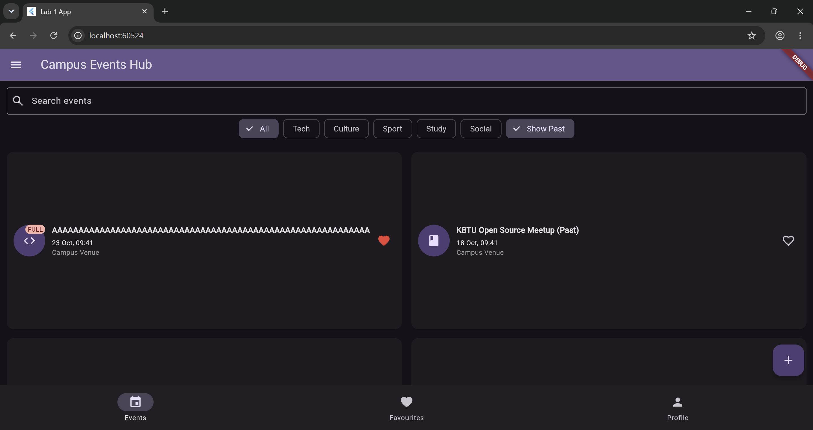

# Campus Events Hub (Lab 1)

Mobile application built with Flutter for managing campus events, attendees, and registrations.

## Screenshots

| Phone Light Theme | Phone Dark Theme | Tablet Grid View |
| :---: | :---: | :---: |
|  |  |  |

## Decisions

1. **State Location**: The master list of items and the user profile live in the root `MyApp` and `ShellScreen` states, ensuring centralized control while tabs receive them via constructor parameters and send updates upward using callbacks.
2. **Callbacks vs. Return Values**: The detail screen takes callbacks to modify or delete items because it acts on existing state, whereas the form screen returns a new `Item` object through `Navigator.pop` upon successful validation[cite: 1].
3. **Responsive Grid Layout**: The event list uses a `LayoutBuilder` rather than `MediaQuery` to check parent constraints dynamically, switching seamlessly from a phone list to a two-column grid when width reaches or exceeds 600 pixels[cite: 1].
4. **Unsaved Changes Guard**: The `PopScope` widget compares the form's current controller and field values against the initial snapshot taken upon opening to determine if the form is dirty and needs a confirmation dialog[cite: 1].
5. **Future Improvements**: With week 9's state management and local storage tools, we would replace manual callback drilling with an inherited provider or BLoC pattern and persist data locally using SQLite or Hive.
